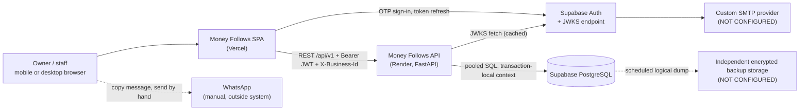
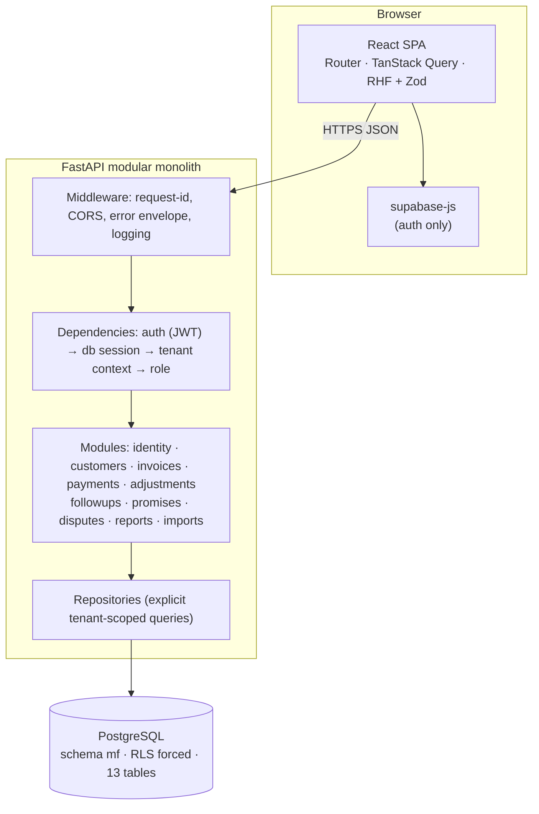
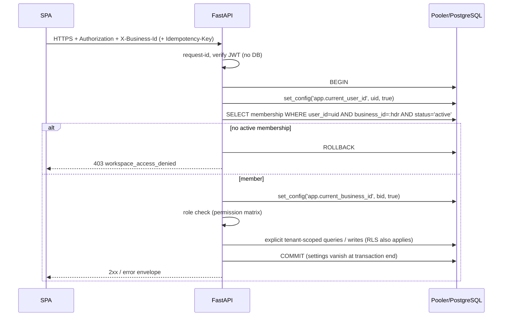
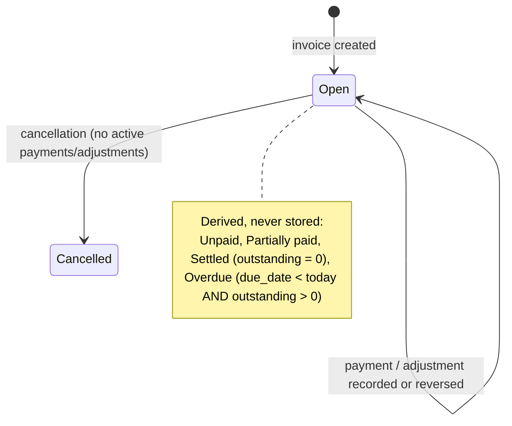
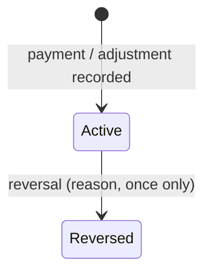
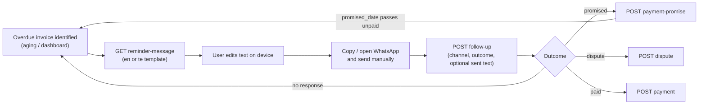
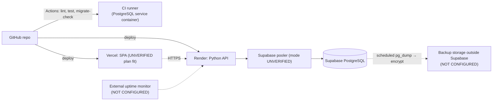

# docs/ARCHITECTURE.md

# Money Follows — Architecture

> **Status statement:** This is a design document. No component described here has been built, executed or verified. Any provider configuration not proven by recorded evidence remains **NOT CONFIGURED**. Provider facts are **UNVERIFIED** until checked against current official documentation.

## 1. System overview

Money Follows is a **mobile-first responsive web application** for receivables management and payment follow-up for Indian MSMEs.

- It is a modular monolith with a versioned REST API (`/api/v1`).
- It has one repository, one React frontend, one Python backend and one PostgreSQL database.
- It is not an accounting or ERP system.
- It sends no automated WhatsApp messages.

Locked stack:

| Layer | Technology |
|---|---|
| Backend | Python 3.12, FastAPI, Pydantic v2, SQLAlchemy 2.x (sync), psycopg 3, Alembic, HTTPX, pytest, Ruff, PyJWT + PyJWKClient |
| Frontend | React, TypeScript (strict), Vite, Tailwind CSS, React Router, TanStack Query, React Hook Form, Zod, Vitest, React Testing Library, Playwright, ESLint, Prettier |
| Data/identity | Supabase PostgreSQL, Supabase Auth |
| Hosting/engineering | Render (API), Vercel (frontend; plan suitability UNVERIFIED), GitHub, GitHub Actions |

Not used: Node.js backend, Redis, Celery, Kubernetes, microservices, message brokers, payment gateways, LLM integrations, automated WhatsApp sending.

Notes on the stack:
- The frontend uses the Supabase browser client only for authentication (OTP sign-in, session refresh). All business data goes through the Python API.
- FastAPI endpoints are plain `def` functions, because sessions are synchronous and FastAPI runs them in a threadpool.

## 2. System context (Mermaid)



## 3. Application / container view (Mermaid)



Planned repository layout (not created yet):

```
backend/app/{main.py,config.py,auth/,db/,modules/<module>/{router,schemas,service,repo}.py,errors.py,logging.py}
backend/alembic/ backend/tests/
frontend/src/{routes,components,features,api,lib,i18n}/ frontend/e2e/
docs/ .github/workflows/
```

Only `db/session.py` and the tenant dependency may set transaction context. Routers never touch settings.

## 4. Request and transaction flow



Rules:
- One request is one transaction on one connection.
- Settings are transaction-local only.
- Any exception causes ROLLBACK and a redacted log entry.
- `X-Business-Id` is a selector, never proof of access.

## 5. JWT authentication flow

```mermaid
sequenceDiagram
  participant S as SPA (supabase-js)
  participant A as FastAPI
  participant J as JWKS endpoint
  S->>A: Bearer access token
  A->>A: read header: alg ∈ {ES256, RS256}, kid present
  A->>A: key cached? if not and cooldown elapsed → fetch JWKS
  A->>J: GET jwks (timeout, only on cache miss)
  A->>A: jwt.decode(alg allow-list, aud=authenticated, iss=expected, require exp, sub, aud, iss)
  A->>A: reject anonymous tokens; sub must be UUID
  A-->>S: proceed, or 401 unauthenticated / token_expired
```

Details are in `SECURITY.md` §2 and §3.

## 6. Multi-tenant authorization flow

On every protected request, in order:
1. JWT identity is verified.
2. `X-Business-Id` is parsed as a UUID, or the request gets 422.
3. An active membership is read for `(user, business)`. Absent or inactive gives `403 workspace_access_denied`, with the same response for a nonexistent and a non-member workspace.
4. The role is read from `memberships`, never from the client.
5. The permission matrix (D-4) is checked, otherwise `403 forbidden_role`.
6. Repository queries include `business_id = :ctx` explicitly.
7. By-id lookups outside the tenant return `404 resource_not_found`.
8. RLS and composite FKs are defense in depth.

Request bodies use `extra="forbid"` and never carry business IDs, user IDs, roles, balances or statuses.

## 7. Invoice and payment lifecycle





Rules:
- Invoice total is independent of payment history.
- Outstanding = total − Σ active payments − Σ active adjustments, and it must stay ≥ 0.
- Payment recording: idempotency-key insert → `SELECT … FOR UPDATE` on the invoice → recompute outstanding → reject overpayment → insert payment → audit log → store idempotent response → COMMIT.
- Reversing a payment or adjustment also locks the invoice, but it can only increase outstanding, so no balance recheck is needed.
- Nothing financial is hard-deleted.

## 8. Collection reminder lifecycle



## 9. Mobile-first frontend architecture

- **Breakpoints:** the base style targets 360 px. `md` (768 px) and `lg` (1024 px) enhance. No fixed-width layouts.
- **Navigation:** a bottom tab bar on mobile with Home, Invoices, Customers and More (Promises, Disputes, Reports, Import, Account). The same routes appear in a left rail at `lg`. Tab targets are at least 44 × 44 px. The bottom bar respects safe-area insets.
- **Lists:** invoices and customers render as cards on mobile, with customer, invoice number, due date, a prominent outstanding amount and a status chip. Compact tables appear only at `md` and above. Core tasks never need horizontal scrolling.
- **Forms:**
  - Short single-column forms.
  - `inputMode="decimal"` for rupee amounts. Zod mirrors the server rule: at most two decimals, no exponent.
  - `type="tel"` for phone numbers and `type="date"` for dates.
  - A focused field scrolls into view above the virtual keyboard. Layouts use `dvh` units.
  - Sticky bars never cover fields (bottom padding equals bar height).
  - The primary action sits in the thumb zone.
- **Payment form:**
  - Full-screen route or sheet, not a small dialog.
  - The idempotency key is generated once per form opening (`crypto.randomUUID()`) and kept until success or until the user edits the values.
  - Confirmation step shows invoice, amount and resulting balance.
- **Destructive/financial actions** (reversal, cancellation, write-off) use a clear confirm screen with the reason field. They are never adjacent to the primary action.
- **Data layer:**
  - TanStack Query: GET retries up to 2 times with backoff, request timeout 15 s, and a "still working…" notice after 3 s. Mutations are in §9

 not retried automatically unless they carry an idempotency key. A payment that times out shows "outcome unknown", with a check-list and a safe retry that reuses the same `Idempotency-Key`.
  - Query timeout is 15 s for GET and 30 s for mutations.
  - The skeleton loader appears immediately. A "still working…" notice appears after 3 s.
  - Every list has loading, empty, error and retry states.
  - On `401 token_expired` the client refreshes the Supabase session once and replays the request (same idempotency key for mutations). A second 401 signs the user out.
  - Server validation is authoritative. Zod only gives early feedback.
- **Cold start / API unavailable:** the SPA calls `GET /health/live` on boot. If it is slower than 3 s it shows "Waking up the server…" and polls for up to 60 s, then shows a retry screen. No financial write is queued offline. The cold-start behaviour of the chosen Render plan is **UNVERIFIED**.
- **i18n:** English and Telugu UI strings are in resource files. Hindi is a future locale and needs no schema change. Telugu fonts are self-hosted or system-stacked, with a fallback. Reminder text comes from the server (§8).
- **Accessibility:** semantic landmarks, labelled inputs, visible focus, contrast of at least 4.5:1, and amounts that are not conveyed by colour alone.
- **Testing:** Vitest and React Testing Library for components. Playwright runs at 360×800, 390×844 and 1280×800 for the workflows in `PRODUCT_SPEC.md` §8. It also runs with the API throttled and with the API down.

## 10. Deployment architecture



- **Environments:** `local`, `ci` and `production`. A separate `staging` project is a deferrable option, and S9 decides whether it is needed. Production data is never used in local or CI.
- **Migrations** run from a trusted workstation or a manual CI job as `mf_migrator`. They are never run by the API process at startup. The runtime connection string has no DDL rights.
- **Release:** a merge to `main` that passes CI deploys the frontend and API. Migrations are applied before the API that needs them. Migrations are backward-compatible with the previous API release (expand, then contract).
- **HTTPS only.** The API sends `Cache-Control: no-store` on all authenticated responses.

## 11. Configuration and secrets management

| Variable | Where | Secret? | Notes |
|---|---|---|---|
| `ENVIRONMENT` | API | no | `local`/`ci`/`production` |
| `DATABASE_URL` | API runtime | **yes** | role `mf_app`, pooler URL. Mode and parameters UNVERIFIED (S0) |
| `MIGRATION_DATABASE_URL` | workstation / manual CI job only | **yes** | role `mf_migrator`. Never set on the API host |
| `SUPABASE_JWKS_URL` | API | no | UNVERIFIED until fetched from the real project |
| `SUPABASE_JWT_ISSUER` | API | no | exact expected `iss` |
| `SUPABASE_JWT_AUDIENCE` | API | no | `authenticated` |
| `CORS_ALLOWED_ORIGINS` | API | no | explicit list, no wildcard |
| `DB_POOL_SIZE`, `DB_MAX_OVERFLOW`, `DB_POOL_TIMEOUT_S`, `DB_STATEMENT_TIMEOUT_MS` | API | no | sized in S0 |
| `LOG_LEVEL` | API | no | |
| `VITE_API_BASE_URL` | frontend build | no | |
| `VITE_SUPABASE_URL`, `VITE_SUPABASE_PUBLIC_KEY` | frontend build | public by design | the key name differs by project vintage (UNVERIFIED). Never a service-role key |

- There is **no `SUPABASE_JWT_SECRET`** and **no service-role key** in V1.
- Secrets live only in the provider dashboards (Render, GitHub Actions secrets). They are never committed. `.env.example` has placeholders only.
- Settings are validated at startup (Pydantic settings). The API refuses to start if a required value is missing, if `CORS_ALLOWED_ORIGINS` contains `*`, or if `ENVIRONMENT=production` and any URL is not HTTPS.
- Rotation: DB passwords and backup keys have a documented rotation procedure (S9). Rotation of each secret is **NOT CONFIGURED** until performed.

## 12. Logging, health checks and error handling

- **Logging:**
  - Structured JSON to stdout.
  - Each line has `ts`, `level`, `request_id`, `user_id` (UUID), `business_id`, `method`, `route_template`, `status`, `duration_ms` and `error_code`.
  - Never logged: Authorization headers, tokens, request or response bodies, customer names or phones, CSV content, reminder text or DB URLs.
  - A redaction filter plus a test enforces this.
- **Health:**
  - `GET /health/live` has no dependencies and returns 200 if the process runs.
  - `GET /health/ready` runs `SELECT 1` with a short timeout using `mf_app`, and returns 503 on failure.
  - Neither endpoint requires authentication. Neither returns versions, config or error detail.
- **Errors:** one envelope for every error (`API.md` §2). Unhandled exceptions give a generic 500 with a `request_id`. The detail goes only to the redacted log. Database constraint violations are mapped to specific codes and never echoed raw.
- **Monitoring:** an external uptime check on `/health/ready` is essential. Error-tracking SaaS is deferrable and not chosen.

## 13. Backup and recovery strategy

1. **Provider backups:** Supabase production backups on a suitable plan. Capability and retention are **UNVERIFIED**. Point-in-time recovery is not assumed.
2. **Independent logical backups:** a scheduled `pg_dump` of schema `mf` (custom format) is encrypted and stored outside the primary database service. The tool, schedule and location are decided in S9. Frequency is at least daily (proposed).
3. **Restore drill (recorded):** restore the latest independent backup into an empty PostgreSQL instance, then run all migrations checks, the R1–R11 isolation tests and the financial smoke tests (create invoice → pay → reverse → aging totals match). Record date, backup age, duration and results in `docs/evidence/`.
4. **Targets (proposed, unverified):** RPO 24 h, RTO 4 h for the pilot. They are adjusted after the first drill.
5. **Auth data** (`auth.users`) is owned by Supabase. How it is restored is **UNVERIFIED** and must be understood in the drill.
6. Backups contain PII and financial data. They are encrypted, access-limited and covered by the retention review (`SECURITY.md` §16).

Status: **NOT CONFIGURED**.

## 14. Essential versus deferrable infrastructure

| Essential before real data | Deferrable |
|---|---|
| Backups and restore drill; CI with a real-PostgreSQL job; uptime monitor; custom SMTP; CORS and health verified; log redaction; secret rotation procedure; privacy notice | Staging environment; error-tracking SaaS; PWA installability; rate limiting beyond provider defaults; read replicas; Hindi UI; invitations and staff-management UI; data export; WhatsApp automation (excluded) |

## 15. Endpoint inventory (single source; identical in `API.md` and `PRODUCT_SPEC.md`)

Base path `/api/v1`. The `X-Business-Id` header is required for all except `/me`, `/businesses` and `/health/*`.

| # | Method and path | Min role |
|---|---|---|
| 1 | GET `/me` | any user |
| 2 | PATCH `/me` | any user |
| 3 | GET `/businesses` | any user |
| 4 | POST `/businesses` | any user |
| 5 | GET `/members` | staff |
| 6–9 | POST `/customers`, GET `/customers`, GET/PATCH `/customers/{customer_id}` | staff |
| 10–13 | POST `/invoices`, GET `/invoices`, GET/PATCH `/invoices/{invoice_id}` | staff |
| 14 | POST `/invoices/{invoice_id}/cancel` | admin |
| 15 | GET `/invoices/{invoice_id}/reminder-message` | staff |
| 16–17 | POST/GET `/invoices/{invoice_id}/payments` (POST needs Idempotency-Key) | staff |
| 18 | POST `/payments/{payment_id}/reverse` | admin |
| 19–20 | POST/GET `/invoices/{invoice_id}/adjustments` | POST admin, GET staff |
| 21 | POST `/adjustments/{adjustment_id}/reverse` | admin |
| 22–23 | POST `/invoices/{invoice_id}/follow-ups`, GET `/follow-ups` | staff |
| 24–26 | POST `/invoices/{invoice_id}/promises`, GET `/promises`, PATCH `/promises/{promise_id}` | staff |
| 27–28 | POST `/invoices/{invoice_id}/disputes`, GET `/disputes` | staff |
| 29 | POST `/disputes/{dispute_id}/resolve` | admin |
| 30 | GET `/dashboard/summary` | staff |
| 31–32 | GET `/reports/invoice-aging`, GET `/reports/customer-outstanding` | staff |
| 33–35 | POST `/imports/preview`, GET `/imports/{import_id}`, POST `/imports/{import_id}/commit` | admin |
| — | GET `/health/live`, GET `/health/ready` (unversioned, no auth) | none |

"admin" means admin or owner. "staff" means all three roles.

## 16. Implementation roadmap S0–S10

Common rule for every phase: it is complete only when the listed **evidence** is stored in `docs/evidence/<phase>/` (command output, not summaries). Mobile responsiveness is a requirement from S6 onward, and the S6 design constraints are fixed by §9 before any implementation.

### S0 — RLS, connection-pool and JWKS feasibility spike
- **Scope:** a throwaway `spike/` with the minimal schema (`businesses`, `memberships`, `customers`, `invoices`, `payments`), the roles, the policies, `mf_create_business`, and a minimal FastAPI JWT dependency.
- **Files:** `spike/schema.sql`, `spike/test_r1_r11.py`, `spike/jwks_check.py`, `docs/evidence/S0/*`.
- **Prerequisites:** a Supabase project, its pooler connection string, and a local PostgreSQL of the same major version.
- **Acceptance:**
  - R1–R11 pass on local PostgreSQL **and** through the real Supabase pooler.
  - A real Supabase ES256/RS256 token verifies through its JWKS.
  - Generated-column expressions create successfully.
  - Findings on the `prepare_threshold` setting and the pool-size decision are recorded.
- **Tests / commands:** `python -m pytest spike/test_r1_r11.py -v`, `python spike/jwks_check.py`.
- **Evidence:** full pytest output for both targets, the `pg_roles` and `pg_class` query output, and the token header (alg and kid only, never the token).
- **Limitations:** go/no-go gate, see `SECURITY.md` §6. A failure means NO-GO and `DECISIONS.md` D-6/D-7 are reopened.

### S1 — Foundation, configuration, CI and migrations
- **Scope:** repo skeleton, settings validation, error envelope, logging with redaction, health endpoints, Alembic baseline for all 13 tables, roles, RLS and triggers (from `DATABASE.md`), and the CI pipeline.
- **Files:** `backend/{pyproject.toml,app/*,alembic/*,tests/*}`, `frontend/*` (Vite scaffold only), `.github/workflows/ci.yml`, `.env.example`.
- **Prerequisites:** S0 GO.
- **Acceptance:** `alembic upgrade head` and `downgrade` on an empty CI database. The R1–R11 suite is ported and passing in CI. Ruff clean. Redaction test passes.
- **Tests / commands:** `cd backend && ruff check . && ruff format --check . && alembic upgrade head && pytest -q`; `cd frontend && npm ci && npm run lint && npm run typecheck && npm test`.
- **Evidence:** a green CI run URL and its log.
- **Limitations:** the CI database is not the Supabase pooler. A separate scheduled or manual pooler job re-runs R4/R10.

### S2 — Identity, workspace creation and tenant authorization
- **Scope:** JWT verification (PyJWKClient), the DB session and tenant dependency, `/me`, `/businesses`, `/members`, and the role matrix.
- **Files:** `backend/app/auth/*`, `app/db/session.py`, `app/modules/identity/*`, `tests/test_auth*.py`, `tests/test_tenant*.py`.
- **Prerequisites:** S1, and a Supabase test user.
- **Acceptance:** every auth and API-security test in `SECURITY.md` §14 passes. A cross-tenant access returns the specified codes.
- **Tests / commands:** `pytest -q tests/test_auth.py tests/test_tenant.py`.
- **Evidence:** test output, and a locally generated ES256 JWKS fixture used in CI.
- **Limitations:** the sign-in method (D-12) is not decided.

### S3 — Customers and invoices
- **Scope:** customer and invoice CRUD (no delete), FY and normalization, duplicate detection, derived balances, and the reminder-message endpoint.
- **Files:** `app/modules/{customers,invoices}/*`, `tests/test_customers.py`, `tests/test_invoices.py`.
- **Prerequisites:** S2.
- **Acceptance:** FY boundary cases (31 Mar and 1 Apr), duplicate invoice numbers rejected, cross-tenant customer reference rejected, and unknown body fields rejected.
- **Tests / commands:** `pytest -q tests/test_customers.py tests/test_invoices.py`.
- **Evidence:** test output.
- **Limitations:** the numbering and normalization rules are still pending pilot validation.

### S4 — Payments, reversals, adjustments and idempotency
- **Scope:** payments, adjustments, reversals, row locking, idempotency, duplicate detection, immutability triggers, and the audit log.
- **Files:** `app/modules/{payments,adjustments}/*`, `app/idempotency.py`, `tests/test_payments.py`, `tests/test_adjustments.py`, `tests/test_concurrency.py`.
- **Prerequisites:** S3.
- **Acceptance:** all financial-integrity tests (`SECURITY.md` §13) pass, including two threads paying the same invoice and the same key replayed.
- **Tests / commands:** `pytest -q tests/test_payments.py tests/test_adjustments.py tests/test_concurrency.py`.
- **Evidence:** test output, and the SQL trigger-rejection output.
- **Limitations:** the overpayment/advance policy is pending pilot validation. TDS and credit-note semantics are pending CA validation.

### S5 — Reporting and aging
- **Scope:** the dashboard summary, invoice aging, customer outstanding, and IST date handling.
- **Files:** `app/modules/reports/*`, `tests/test_reports.py`.
- **Prerequisites:** S4.
- **Acceptance:** report totals equal an independent SQL computation on seeded data. Collected cash excludes adjustments and reversed payments.
- **Tests / commands:** `pytest -q tests/test_reports.py`.
- **Evidence:** test output, and a query-plan note at 5,000 invoices.
- **Limitations:** performance at larger sizes is not claimed.

### S6 — Mobile-first frontend vertical slice
- **Scope:** sign-in, workspace creation, the layout shell (bottom nav), the customer list and create, the invoice card list and detail, the payment form, the payment reversal, and the loading/empty/error/retry states.
- **Files:** `frontend/src/{routes,components,features/{auth,customers,invoices,payments},api,lib,i18n}/*`, `frontend/e2e/*.spec.ts`, `frontend/playwright.config.ts`.
- **Prerequisites:** S2–S5 APIs and a running API.
- **Acceptance:** the `PRODUCT_SPEC.md` §8 checklist passes at 360×800, 390×844 and desktop. There is no horizontal scrolling in core flows. The slow-API and API-down tests pass.
- **Tests / commands:** `cd frontend && npm test && npx playwright test`.
- **Evidence:** the Playwright report and screenshots at each viewport.
- **Limitations:** real-device testing is a release gate (S9), not this phase's proof.

### S7 — Collections, promises and disputes
- **Scope:** follow-ups, promises, disputes, the reminder UI (EN/TE, edit, copy, open WhatsApp), and the dashboard promise widgets.
- **Files:** `app/modules/{followups,promises,disputes}/*`, `frontend/src/features/{collections,disputes}/*`, tests and e2e specs.
- **Prerequisites:** S6.
- **Acceptance:** one pending promise per invoice, one open dispute per invoice, and a manual send creates no network call to WhatsApp.
- **Tests / commands:** `pytest -q tests/test_followups.py tests/test_promises.py tests/test_disputes.py`; `npx playwright test e2e/collections.spec.ts`.
- **Evidence:** test output and mobile screenshots.
- **Limitations:** Telugu wording is pending native review.

### S8 — CSV import
- **Scope:** preview, the error report, commit, purge of preview rows, and the import UI on mobile.
- **Files:** `app/modules/imports/*`, `frontend/src/features/imports/*`, `tests/test_imports.py`, the fixture CSVs.
- **Prerequisites:** S7.
- **Acceptance:** the CSV security tests (`SECURITY.md` §12) pass. Commit is atomic. Preview rows are null after commit.
- **Tests / commands:** `pytest -q tests/test_imports.py`.
- **Evidence:** test output and a DB query showing the purge.
- **Limitations:** only 6 columns, and invoices only (no payments import).

### S9 — Security hardening, deployment and release gates
- **Scope:** the production deployment, CORS and health verification, backups, the restore drill, SMTP, secret rotation, a real-device test, and the privacy notice and pilot terms review.
- **Files:** `docs/evidence/S9/*`, `docs/RUNBOOK.md` (new), deployment configs.
- **Prerequisites:** S8.
- **Acceptance:** every item in §17 has evidence.
- **Tests / commands:** the full CI suite, the R1–R11 suite against production-like infrastructure, and the restore-drill script.
- **Evidence:** per §17.
- **Limitations:** provider facts verified here carry a verification date.

### S10 — Controlled pilot
- **Scope:** a small pilot (proposed 3–5 businesses), weekly check-ins, and metrics per `PRODUCT_SPEC.md` §12.
- **Files:** `docs/PILOT_LOG.md` (new).
- **Prerequisites:** S9 complete, pilot terms signed.
- **Acceptance:** the pilot questions are answered and decisions D-1, D-2, D-4 and D-10 are confirmed or revised.
- **Tests / commands:** none beyond monitoring.
- **Evidence:** the pilot log and the decision updates.
- **Limitations:** the targets are validation goals, not promises.

## 17. Release-gate checklist (all items currently NOT CONFIGURED)

| # | Gate | Status | Evidence required |
|---|---|---|---|
| 1 | Supabase production backups on a verified plan | NOT CONFIGURED | dashboard screenshot and the plan's official doc link with date |
| 2 | Independent encrypted logical backups outside the primary service | NOT CONFIGURED | job log, the stored object listing, a decrypt test |
| 3 | Recorded restore drill | NOT CONFIGURED | `docs/evidence/S9/restore-drill.md` |
| 4 | Post-restore migrations, isolation tests, financial smoke tests | NOT CONFIGURED | pytest output on the restored DB |
| 5 | Custom SMTP verified for auth emails | NOT CONFIGURED | a delivered test OTP to 2 mail providers |
| 6 | Always-on API hosting or a designed, monitored cold start | NOT CONFIGURED | plan details (UNVERIFIED), the monitor config |
| 7 | Production CORS and health checks verified | NOT CONFIGURED | curl output from the production origin and a disallowed origin |
| 8 | Secrets configured and rotated | NOT CONFIGURED | the rotation record, with no secret values |
| 9 | Privacy notice and pilot terms reviewed | NOT CONFIGURED | the reviewer's written confirmation |
| 10 | Mobile workflows on real browsers and required viewports | NOT CONFIGURED | the device and browser matrix and screenshots |
| 11 | S0 go/no-go passed | NOT CONFIGURED | S0 evidence |

Do not store real customer financial data until every row has evidence.
