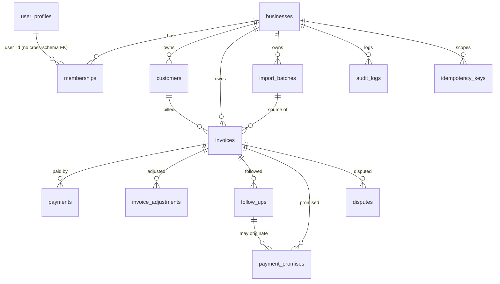

# docs/DATABASE.md

# Money Follows — Database Design

> **Status:** design only. All SQL is **ILLUSTRATIVE** and has not been executed against any database. PostgreSQL version, generated-column behaviour, pooler behaviour and RLS behaviour on Supabase are **UNVERIFIED** until S0 evidence exists.

## 1. Conventions

- Schema `mf` holds all application objects. It is not intended to be exposed via the Supabase Data API. `anon` and `authenticated` roles get no privileges on it (verified in R11).
- **Roles:**
  - `mf_migrator` owns the objects and runs DDL only.
  - `mf_definer` owns `mf.mf_create_business` and has no login.
  - `mf_app` is the runtime role: not a superuser, no BYPASSRLS, not an owner, no DDL.
- **Primary keys** are `uuid` with default `gen_random_uuid()`.
- **Timestamps** are `timestamptz`, default `now()`. `updated_at` is maintained by a trigger.
- **Money** is `bigint` paise with `CHECK (x > 0 AND x <= 99999999999999)`. This is ₹999,999,999,999.99, which is also safe as a JavaScript integer.
- **Dates:** business dates are `date` in IST (`Asia/Kolkata`). "Today" is `(now() AT TIME ZONE 'Asia/Kolkata')::date`.
- **Enums** are `text` with CHECK constraints (easier to migrate than PG enums).
- **Tenant key:** every tenant table has `business_id uuid NOT NULL REFERENCES mf.businesses(id) ON DELETE RESTRICT`.
- Each tenant parent has `UNIQUE (business_id, id)` so children use **composite foreign keys** `(business_id, parent_id) → parent(business_id, id)`.
- **Deletion:** `ON DELETE RESTRICT` everywhere. `mf_app` has no DELETE privilege except on expired `idempotency_keys`.
- **MATCH SIMPLE note:** for a nullable composite FK (e.g. `follow_up_id`), PostgreSQL skips the check if any column is NULL. That is intended, because `business_id` is never NULL and the FK is checked whenever the reference is present.
- **Audit:** every state-changing financial or workflow write inserts an `audit_logs` row in the same transaction.

## 2. ER diagram



## 3. Context helpers and the standard tenant policies

```sql
-- ILLUSTRATIVE, NOT EXECUTED
CREATE FUNCTION mf.current_business_id() RETURNS uuid
LANGUAGE sql STABLE
AS $$ SELECT NULLIF(pg_catalog.current_setting('app.current_business_id', true), '')::uuid $$;

CREATE FUNCTION mf.current_user_id() RETURNS uuid
LANGUAGE sql STABLE
AS $$ SELECT NULLIF(pg_catalog.current_setting('app.current_user_id', true), '')::uuid $$;
```

- Missing or empty setting gives NULL, so `business_id = NULL` is never true and **zero rows match** (fail closed).
- A malformed UUID raises an error (also fail closed). Both are tested in R1 and R6.
- The application sets context only with `SELECT set_config('app.current_user_id', :v, true)` (transaction-local). Never `SET`, never `set_config(..., false)`.

**Standard tenant policies (STP)** for a table `T` with `business_id`:

```sql
-- ILLUSTRATIVE, NOT EXECUTED
ALTER TABLE mf.T ENABLE ROW LEVEL SECURITY;
ALTER TABLE mf.T FORCE ROW LEVEL SECURITY;

CREATE POLICY stp_select ON mf.T FOR SELECT TO mf_app
  USING (business_id = (SELECT mf.current_business_id()));
CREATE POLICY stp_insert ON mf.T FOR INSERT TO mf_app
  WITH CHECK (business_id = (SELECT mf.current_business_id()));
CREATE POLICY stp_update ON mf.T FOR UPDATE TO mf_app
  USING (business_id = (SELECT mf.current_business_id()))
  WITH CHECK (business_id = (SELECT mf.current_business_id()));
-- no DELETE policy: with RLS forced and no policy, DELETE affects zero rows; the DELETE privilege is also not granted
```

Only the policies relevant to a table's granted privileges are created. The `(SELECT …)` wrapper lets the planner evaluate the function once.

## 4. Tables

### 4.1 `businesses`
- **Purpose:** a workspace (tenant).
- **Tenant ownership:** the row is the tenant, with `id` as the tenant key.

| column | type | null | notes |
|---|---|---|---|
| id | uuid PK | no | |
| name | text | no | CHECK length(btrim(name)) BETWEEN 2 AND 120 |
| default_language | text | no | CHECK IN ('en','te'), default 'en' |
| created_by | uuid | no | auth user id (no FK) |
| created_at, updated_at | timestamptz | no | |

- **Constraints and indexes:** UNIQUE (id) via the PK. The composite-FK anchor is the PK itself.
- **Deletion:** never. `mf_app` has no INSERT, UPDATE or DELETE. Rows are created only by `mf_create_business`.
- **Audit:** `business.created` is written by the function.
- **RLS:** `biz_select` for `mf_app` USING `EXISTS (SELECT 1 FROM mf.memberships m WHERE m.business_id = businesses.id AND m.user_id = (SELECT mf.current_user_id()) AND m.status = 'active')`. This lets `GET /businesses` list the user's workspaces before a business context exists. `biz_definer_insert` for `mf_definer` WITH CHECK `created_by = (SELECT mf.current_user_id())`.
- **Relationships:** parent of every tenant table.

### 4.2 `user_profiles`
- **Purpose:** per-user preferences for the identity subject (not tenant data).
- **Tenant ownership:** none, it is user-scoped.

| column | type | null | notes |
|---|---|---|---|
| user_id | uuid PK | no | equals the JWT `sub`. No FK to `auth.users` (cross-schema, provider-owned). Orphans are tolerated |
| display_name | text | yes | length ≤ 80 |
| preferred_language | text | no | CHECK IN ('en','te'), default 'en' |
| created_at, updated_at | timestamptz | no | |

- **Deletion:** never by the application.
- **Audit:** not required (no financial effect).
- **RLS (ENABLE + FORCE):** `up_select`, `up_insert` (WITH CHECK) and `up_update` (USING and WITH CHECK) for `mf_app`, all with `user_id = (SELECT mf.current_user_id())`.
- **Relationships:** logical link to `memberships.user_id`.

### 4.3 `memberships`
- **Purpose:** links a user to a business with a role.
- **Tenant ownership:** `business_id`.

| column | type | null | notes |
|---|---|---|---|
| id | uuid PK | no | |
| business_id | uuid FK → businesses | no | |
| user_id | uuid | no | |
| role | text | no | CHECK IN ('owner','admin','staff') |
| status | text | no | CHECK IN ('active','inactive'), default 'active' |
| created_at, updated_at | timestamptz | no | |

- **Constraints:** UNIQUE (business_id, user_id). UNIQUE (business_id, id). A partial unique index on `(business_id) WHERE role='owner' AND status='active'`. Index on `(user_id) WHERE status='active'`.
- **Deletion:** never. `mf_app` has SELECT only.
- **Audit:** the creation of the owner membership is logged inside `mf_create_business`.
- **RLS:** `mem_self_select` USING `user_id = (SELECT mf.current_user_id())`, which is needed before the business is known. `mem_tenant_select` USING `business_id = (SELECT mf.current_business_id())`, for the members list. `mem_definer_insert` for `mf_definer` WITH CHECK `role='owner' AND user_id = (SELECT mf.current_user_id())`. `mem_definer_select` for `mf_definer` USING `user_id = (SELECT mf.current_user_id())`, used for the per-user business limit.
- **Relationships:** links `user_profiles` and `businesses`.

### 4.4 `customers`
- **Purpose:** the buyer being invoiced.
- **Tenant ownership:** `business_id`.

| column | type | null | notes |
|---|---|---|---|
| id | uuid PK | no | |
| business_id | uuid FK | no | |
| name | text | no | CHECK length(btrim(name)) BETWEEN 1 AND 120 (the placeholder `[anonymized]` also satisfies it) |
| name_normalized | text GENERATED ALWAYS AS (lower(btrim(regexp_replace(name, '\s+', ' ', 'g')))) STORED | no | **needs compatibility test** |
| phone | text | yes | normalized `+91` plus 10 digits, CHECK `phone ~ '^\+91[6-9][0-9]{9}$'` |
| notes | text | yes | length ≤ 1000 |
| preferred_language | text | no | IN ('en','te'), default 'en' |
| is_active | boolean | no | default true |
| anonymized_at | timestamptz | yes | |
| created_by | uuid | no | |
| created_at, updated_at | timestamptz | no | |

- **Constraints and indexes:** UNIQUE (business_id, id). A partial unique index `(business_id, phone) WHERE phone IS NOT NULL`. Index `(business_id, name_normalized)` (non-unique, to warn on duplicate names). Index `(business_id, is_active)`.
- **Deletion:** never (RESTRICT, and no privilege). Deactivation is `is_active=false`. Anonymization is a manual audited procedure (D-5).
- **Audit:** `customer.created` and `customer.updated` (changed field names only, not values).
- **RLS:** STP select, insert and update.
- **Relationships:** parent of `invoices`.

### 4.5 `invoices`
- **Purpose:** the receivable. The original amount never changes with payments.
- **Tenant ownership:** `business_id`.

| column | type | null | notes |
|---|---|---|---|
| id | uuid PK | no | |
| business_id | uuid | no | |
| customer_id | uuid | no | |
| invoice_number | text | no | length 1–40, as entered |
| invoice_number_normalized | text GENERATED ALWAYS AS (upper(regexp_replace(invoice_number, '\s+', '', 'g'))) STORED | no | **needs compatibility test** |
| invoice_date | date | no | immutable |
| due_date | date | no | CHECK due_date >= invoice_date |
| fy_start_year | smallint GENERATED ALWAYS AS ((EXTRACT(YEAR FROM invoice_date)::int - CASE WHEN EXTRACT(MONTH FROM invoice_date) < 4 THEN 1 ELSE 0 END)::smallint) STORED | no | **needs compatibility test** |
| total_paise | bigint | no | CHECK range above; immutable |
| status | text | no | IN ('open','cancelled'), default 'open' |
| cancelled_at, cancelled_by, cancel_reason | timestamptz, uuid, text | yes | all-or-none CHECK |
| source | text | no | IN ('manual','import'), default 'manual' |
| import_batch_id | uuid | yes | composite FK to import_batches |
| notes | text | yes | length ≤ 1000 |
| created_by | uuid | no | |
| created_at, updated_at | timestamptz | no | |

```sql
-- ILLUSTRATIVE, NOT EXECUTED
CREATE TABLE mf.invoices (
  id uuid PRIMARY KEY DEFAULT gen_random_uuid(),
  business_id uuid NOT NULL REFERENCES mf.businesses(id) ON DELETE RESTRICT,
  customer_id uuid NOT NULL,
  invoice_number text NOT NULL CHECK (length(invoice_number) BETWEEN 1 AND 40),
  invoice_number_normalized text GENERATED ALWAYS AS
    (upper(regexp_replace(invoice_number, '\s+', '', 'g'))) STORED,
  invoice_date date NOT NULL,
  due_date date NOT NULL,
  fy_start_year smallint GENERATED ALWAYS AS
    ((EXTRACT(YEAR FROM invoice_date)::int
      - CASE WHEN EXTRACT(MONTH FROM invoice_date) < 4 THEN 1 ELSE 0 END)::smallint) STORED,
  total_paise bigint NOT NULL CHECK (total_paise BETWEEN 1 AND 99999999999999),
  status text NOT NULL DEFAULT 'open' CHECK (status IN ('open','cancelled')),
  -- remaining columns as in the table above
  CONSTRAINT invoices_due_after_invoice CHECK (due_date >= invoice_date),
  CONSTRAINT invoices_biz_id_uq UNIQUE (business_id, id),
  CONSTRAINT invoices_number_fy_uq UNIQUE (business_id, fy_start_year, invoice_number_normalized),
  CONSTRAINT invoices_customer_fk FOREIGN KEY (business_id, customer_id)
    REFERENCES mf.customers (business_id, id) ON DELETE RESTRICT
);
```

- **Indexes:** `(business_id, due_date, id) WHERE status='open'`, `(business_id, customer_id)`, `(business_id, fy_start_year)`.
- **Deletion:** never. Cancellation is allowed only when there are no active payments or adjustments (checked under the invoice lock).
- **Immutability trigger (BEFORE UPDATE):** `business_id`, `customer_id`, `invoice_number`, `invoice_date`, `total_paise` and `source` cannot change. `status` may change only open→cancelled.
- **Audit:** `invoice.created`, `invoice.updated`, `invoice.cancelled`.
- **RLS:** STP select, insert and update.
- **Relationships:** parent of `payments`, `invoice_adjustments`, `follow_ups`, `payment_promises` and `disputes`.
- **Derived (never stored):** paid, adjusted, outstanding, payment_state and is_overdue (see §5).

### 4.6 `payments`
- **Purpose:** actual cash received against one invoice. It is append-only apart from reversal.
- **Tenant ownership:** `business_id`.

| column | type | null | notes |
|---|---|---|---|
| id | uuid PK | no | |
| business_id | uuid | no | |
| invoice_id | uuid | no | |
| amount_paise | bigint | no | range CHECK |
| paid_on | date | no | enforced by the service to be ≥ invoice_date and ≤ today (IST). The trigger repeats the check on INSERT |
| method | text | no | IN ('cash','upi','bank_transfer','cheque','other') |
| reference | text | yes | length ≤ 60 (UTR, cheque no.) |
| note | text | yes | length ≤ 500 |
| status | text | no | IN ('active','reversed'), default 'active' |
| reversed_at, reversed_by, reversal_reason | timestamptz, uuid, text | yes | |
| created_by | uuid | no | |
| created_at | timestamptz | no | |

```sql
-- ILLUSTRATIVE, NOT EXECUTED
CONSTRAINT payments_reversal_consistent CHECK (
  (status = 'active'   AND reversed_at IS NULL AND reversed_by IS NULL AND reversal_reason IS NULL) OR
  (status = 'reversed' AND reversed_at IS NOT NULL AND reversed_by IS NOT NULL
                       AND length(btrim(reversal_reason)) BETWEEN 3 AND 300))
```

- **Constraints and indexes:** UNIQUE (business_id, id). Composite FK `(business_id, invoice_id) → invoices (business_id, id)`. Index `(business_id, invoice_id) WHERE status='active'`. Index `(business_id, paid_on) WHERE status='active'` (for cash reports). Index `(business_id, invoice_id, amount_paise, paid_on)` (for duplicate detection).
- **Deletion:** never. `mf_app` has no DELETE or TRUNCATE. A trigger rejects DELETE for all roles.
- **Immutability trigger (BEFORE UPDATE):** only `status`, `reversed_at`, `reversed_by` and `reversal_reason` may change, only active→reversed, and only once.
- **Audit:** `payment.recorded`, `payment.reversed`.
- **RLS:** STP select and insert. `stp_update` is allowed, but the trigger limits it to reversal.
- **Duplicate detection:** see §6.
- **Relationships:** child of `invoices`.

### 4.7 `invoice_adjustments`
- **Purpose:** non-cash reductions of the receivable. It never counts as collected cash. The system never calculates TDS or GST, the user enters the amount.
- **Tenant ownership:** `business_id`.

| column | type | null | notes |
|---|---|---|---|
| id | uuid PK | no | |
| business_id, invoice_id | uuid | no | composite FK like `payments` |
| kind | text | no | IN ('tds','discount','credit_note','write_off') |
| amount_paise | bigint | no | range CHECK |
| adjusted_on | date | no | |
| reference | text | yes | length ≤ 60 (e.g. credit-note no.) |
| reason | text | no | length 3–300. Required for every kind, and it documents write-offs |
| status, reversed_at, reversed_by, reversal_reason | as in `payments` | | same consistency CHECK |
| created_by, created_at | | no | |

- **Constraints and indexes:** UNIQUE (business_id, id). Index `(business_id, invoice_id) WHERE status='active'`.
- **Deletion, immutability, audit:** as for `payments`. Actions are `adjustment.recorded` and `adjustment.reversed`.
- **RLS:** as for `payments`.
- **Relationships:** child of `invoices`.

### 4.8 `follow_ups`
- **Purpose:** an append-only log of collection contact attempts.
- **Tenant ownership:** `business_id`.

| column | type | null | notes |
|---|---|---|---|
| id | uuid PK | no | |
| business_id, invoice_id | uuid | no | composite FK |
| channel | text | no | IN ('whatsapp','call','visit','other') |
| outcome | text | no | IN ('no_response','contacted','promised','disputed','refused','other') |
| language | text | yes | IN ('en','te') |
| message_text | text | yes | the text actually sent, ≤ 2000 chars. **Contains PII** |
| note | text | yes | ≤ 1000 |
| followed_up_at | timestamptz | no | default now() |
| created_by | uuid | no | |
| created_at | timestamptz | no | |

- **Constraints and indexes:** UNIQUE (business_id, id). Index `(business_id, invoice_id, followed_up_at DESC)`.
- **Deletion, immutability:** the trigger rejects DELETE for all roles. It rejects UPDATE unless `current_user = 'mf_migrator'` and only `message_text` or `note` change (the manual anonymization procedure). `mf_app` has SELECT and INSERT only.
- **Audit:** `followup.created`.
- **RLS:** STP select and insert.
- **Relationships:** child of `invoices`, optional parent of `payment_promises`.

### 4.9 `payment_promises`
- **Purpose:** a promised payment date for an invoice.
- **Tenant ownership:** `business_id`.

| column | type | null | notes |
|---|---|---|---|
| id | uuid PK | no | |
| business_id, invoice_id | uuid | no | composite FK |
| follow_up_id | uuid | yes | composite FK `(business_id, follow_up_id)` |
| promised_date | date | no | |
| promised_amount_paise | bigint | yes | range CHECK |
| status | text | no | IN ('pending','kept','broken','cancelled'), default 'pending' |
| note | text | yes | ≤ 500 |
| resolved_at | timestamptz | yes | CHECK `(status='pending') = (resolved_at IS NULL)` |
| created_by | uuid | no | |
| created_at, updated_at | timestamptz | no | |

- **Constraints and indexes:** UNIQUE (business_id, id). A partial unique index `(invoice_id) WHERE status='pending'` (one pending promise per invoice). Index `(business_id, promised_date) WHERE status='pending'`.
- **Immutability trigger:** the fields `business_id`, `invoice_id`, `promised_date`, `promised_amount_paise` and `created_*` are fixed. The status may move only from pending to another value.
- **Deletion:** never. `mf_app` has SELECT, INSERT and UPDATE.
- **Audit:** `promise.created`, `promise.resolved`.
- **RLS:** STP select, insert and update.
- **Overdue promise** (derived): `status='pending' AND promised_date < today`.

### 4.10 `disputes`
- **Purpose:** a customer dispute about an invoice.
- **Tenant ownership:** `business_id`.

| column | type | null | notes |
|---|---|---|---|
| id | uuid PK | no | |
| business_id, invoice_id | uuid | no | composite FK |
| category | text | no | IN ('quality','quantity','price','delivery','payment_claimed','other') |
| description | text | no | 3–1000 |
| disputed_amount_paise | bigint | yes | range CHECK |
| status | text | no | IN ('open','resolved'), default 'open' |
| resolution_note | text | yes | |
| resolved_at, resolved_by | timestamptz, uuid | yes | CHECK that all three resolution fields are present iff status='resolved' |
| created_by | uuid | no | |
| created_at, updated_at | timestamptz | no | |

- **Constraints and indexes:** UNIQUE (business_id, id). A partial unique index `(invoice_id) WHERE status='open'`. Index `(business_id, status)`.
- **Immutability trigger:** only open→resolved is allowed, and `description` and `category` are immutable.
- **Deletion:** never. **Audit:** `dispute.opened`, `dispute.resolved`.
- **RLS:** STP select, insert and update.
- **Note:** an open dispute does not alter the balance. It is a flag shown on the invoice and the dashboard.

### 4.11 `audit_logs`
- **Purpose:** an append-only record of who did what.
- **Tenant ownership:** `business_id`.

| column | type | null | notes |
|---|---|---|---|
| id | uuid PK | no | |
| business_id | uuid FK → businesses | no | |
| actor_user_id | uuid | no | |
| action | text | no | e.g. `payment.recorded` |
| entity_type | text | no | |
| entity_id | uuid | no | |
| request_id | uuid | yes | |
| detail | jsonb | no | default '{}'. Ids, amounts, statuses and changed field names only. **No names, phones or free text** |
| created_at | timestamptz | no | |

- **Indexes:** `(business_id, created_at DESC)`, `(business_id, entity_type, entity_id)`.
- **Deletion and immutability:** a trigger rejects UPDATE and DELETE for all roles. `mf_app` has SELECT and INSERT only.
- **Audit:** it is the audit store. A failure to write the audit row aborts the business transaction.
- **RLS:** STP select and insert, plus `audit_definer_insert` for `mf_definer` WITH CHECK `actor_user_id = (SELECT mf.current_user_id())`. V1 has no API that reads audit logs.

### 4.12 `idempotency_keys`
- **Purpose:** safe retries of payment POSTs, adjustment POSTs and import commit.
- **Tenant ownership:** `business_id`.

| column | type | null | notes |
|---|---|---|---|
| id | uuid PK | no | |
| business_id | uuid FK | no | |
| user_id | uuid | no | |
| key | text | no | CHECK `key ~ '^[A-Za-z0-9_-]{16,128}$'` |
| method, route | text | no | the route template |
| request_hash | bytea | no | SHA-256 of the canonical request body plus path parameters |
| response_status | smallint | yes | set at completion |
| response_body | jsonb | yes | amounts and ids only |
| created_at | timestamptz | no | |
| expires_at | timestamptz | no | default now() + interval '30 days' |

- **Constraints and indexes:** UNIQUE (business_id, key). Index `(expires_at)`.
- **Privileges:** `mf_app` has SELECT, INSERT, `UPDATE (response_status, response_body)`, and DELETE (limited by policy to expired rows).
- **Cleanup:** opportunistic. The same transaction that writes a keyed request deletes at most 50 rows where `expires_at < now()`. There is no scheduler (no Celery or cron).
- **RLS:** STP select, insert and update. `idem_delete` for `mf_app` USING `business_id = (SELECT mf.current_business_id()) AND expires_at < now()`.
- **Audit:** none (it is operational data).

### 4.13 `import_batches`
- **Purpose:** the staging and history of a CSV import.
- **Tenant ownership:** `business_id`.

| column | type | null | notes |
|---|---|---|---|
| id | uuid PK | no | |
| business_id | uuid FK | no | |
| created_by | uuid | no | |
| filename | text | no | display only, length ≤ 200, path characters stripped |
| file_sha256 | bytea | no | |
| status | text | no | IN ('previewed','committed','expired'), default 'previewed' |
| total_rows, valid_rows, error_rows | integer | no | CHECK ≥ 0 |
| preview_rows | jsonb | yes | validated rows and errors. **Contains PII**. Set to NULL at commit and at expiry |
| summary | jsonb | no | counts only (created customers, created invoices, skipped duplicates) |
| created_at | timestamptz | no | |
| expires_at | timestamptz | no | default now() + interval '7 days' |
| committed_at, committed_by | timestamptz, uuid | yes | |

- **Constraints and indexes:** UNIQUE (business_id, id). CHECK `status <> 'committed' OR preview_rows IS NULL`. Index `(business_id, status, expires_at)`.
- **Deletion:** never of the row. Only `preview_rows` is purged. Uncommitted previews are purged after 7 days opportunistically (during any preview request: `UPDATE … SET preview_rows = NULL, status = 'expired' WHERE status='previewed' AND expires_at < now()`).
- **Audit:** `import.previewed`, `import.committed`.
- **RLS:** STP select, insert and update.
- **Relationships:** `invoices.import_batch_id` references it.

## 5. Illustrative SQL — balances and reports

All queries are **ILLUSTRATIVE, NOT EXECUTED**. They always filter by `business_id` explicitly, in addition to RLS. `SUM` of `bigint` yields `numeric`, so it is cast back to `bigint`.

**Per-invoice outstanding balance**
```sql
SELECT i.id, i.invoice_number, i.total_paise,
       COALESCE(p.paid, 0)::bigint AS paid_paise,
       COALESCE(a.adj, 0)::bigint  AS adjusted_paise,
       (i.total_paise - COALESCE(p.paid, 0) - COALESCE(a.adj, 0))::bigint AS outstanding_paise
FROM mf.invoices i
LEFT JOIN LATERAL (
  SELECT SUM(amount_paise) AS paid FROM mf.payments
  WHERE business_id = i.business_id AND invoice_id = i.id AND status = 'active') p ON true
LEFT JOIN LATERAL (
  SELECT SUM(amount_paise) AS adj FROM mf.invoice_adjustments
  WHERE business_id = i.business_id AND invoice_id = i.id AND status = 'active') a ON true
WHERE i.business_id = :business_id AND i.status = 'open';
```

**Customer-wise outstanding**
```sql
WITH bal AS ( /* the per-invoice query above, selecting i.customer_id and outstanding_paise */ )
SELECT c.id, c.name, COUNT(*) FILTER (WHERE bal.outstanding_paise > 0) AS open_invoices,
       SUM(bal.outstanding_paise) AS outstanding_paise
FROM bal JOIN mf.customers c ON c.business_id = :business_id AND c.id = bal.customer_id
GROUP BY c.id, c.name
HAVING SUM(bal.outstanding_paise) > 0
ORDER BY outstanding_paise DESC, c.id
LIMIT :limit OFFSET :offset;
```

**Invoice aging** (as of IST today, by due date)
```sql
WITH bal AS ( /* per-invoice query with i.due_date */ ),
t AS (SELECT (now() AT TIME ZONE 'Asia/Kolkata')::date AS today)
SELECT CASE
  WHEN due_date >= t.today THEN 'current'
  WHEN t.today - due_date BETWEEN 1 AND 30 THEN '1-30'
  WHEN t.today - due_date BETWEEN 31 AND 60 THEN '31-60'
  WHEN t.today - due_date BETWEEN 61 AND 90 THEN '61-90'
  ELSE '90+' END AS bucket,
  COUNT(*) AS invoices, SUM(outstanding_paise) AS outstanding_paise
FROM bal, t WHERE outstanding_paise > 0 GROUP BY 1;
```

**Financial-year boundaries**
```sql
-- FY label for a date: 2026-03-31 → fy_start_year 2025 ('2025-26'); 2026-04-01 → 2026 ('2026-27')
SELECT d, (EXTRACT(YEAR FROM d)::int - CASE WHEN EXTRACT(MONTH FROM d) < 4 THEN 1 ELSE 0 END) AS fy_start_year
FROM (VALUES (DATE '2026-03-31'), (DATE '2026-04-01')) v(d);
-- Invoices of FY 2025-26: WHERE fy_start_year = 2025
-- Equivalent range form (for payments, which have no FY column): paid_on BETWEEN DATE '2025-04-01' AND DATE '2026-03-31'
```

**Collected cash (payments only, never adjustments)**
```sql
SELECT COALESCE(SUM(amount_paise), 0)::bigint FROM mf.payments
WHERE business_id = :business_id AND status = 'active'
  AND paid_on BETWEEN :from AND :to;
```

## 6. Illustrative SQL — idempotent payment recording

One request is one transaction. Context was set earlier with `set_config(..., true)`.

```sql
-- ILLUSTRATIVE, NOT EXECUTED. Parameters bound by the driver, never concatenated.
-- 1. Claim the idempotency key (blocks if a concurrent request holds the same key)
INSERT INTO mf.idempotency_keys (business_id, user_id, key, method, route, request_hash)
VALUES (:business_id, :user_id, :key, 'POST', '/invoices/{id}/payments', :hash)
ON CONFLICT (business_id, key) DO NOTHING
RETURNING id;
-- 0 rows returned: SELECT request_hash, response_status, response_body FROM mf.idempotency_keys
--   WHERE business_id = :business_id AND key = :key;
--   hash differs → 422 idempotency_key_reuse; hash equal → replay stored response (HTTP status and body)
-- 2. Lock the invoice and read its state
SELECT id, total_paise, status FROM mf.invoices
WHERE business_id = :business_id AND id = :invoice_id FOR UPDATE;   -- no row → 404
-- 3. Recompute outstanding under the lock (the per-invoice query, restricted to this id)
-- 4. Reject if status <> 'open' (409) or :amount_paise > outstanding (422 overpayment_rejected)
-- 5. Soft duplicate check (§ duplicate detection); if matched and not allow_duplicate → 409
-- 6. INSERT INTO mf.payments (...) RETURNING id;
-- 7. INSERT INTO mf.audit_logs (...);
-- 8. UPDATE mf.idempotency_keys SET response_status = 201, response_body = :body WHERE id = :key_id;
-- 9. COMMIT   (any failure → ROLLBACK, which also removes the key claim)
```

- **Why no "in progress" state:** the key claim and the payment commit together. A crash rolls both back, so a retry starts clean. A concurrent duplicate waits on the unique index, then sees the committed row and replays.
- **Concurrent different payments** on one invoice serialize on `FOR UPDATE`. The second request recomputes after the first commits, so the sum can never exceed the total (this includes `FOR UPDATE` on the same row for adjustments and reversals).
- **Lock order** is always (invoice row). Nothing else is locked, so there is no deadlock cycle.
- **Duplicate detection (soft):** same `(business_id, invoice_id, amount_paise, paid_on, method)` and, if a reference is given, the same lower-cased reference, among active payments in the last 24 hours (created_at). A match returns `409 possible_duplicate_payment` unless the request body has `"allow_duplicate": true`. This is advisory only. It is not an idempotency mechanism.

## 7. Triggers, generated columns and implementation notes

- **Generated columns:** `STORED` generated columns require immutable expressions. `regexp_replace`, `upper`, `lower`, `btrim` and `EXTRACT` on `date` are expected to qualify, but `upper`/`lower` depend on the database collation, and the return type of `EXTRACT` changed in PostgreSQL 14. This **must be tested** on the real Supabase PostgreSQL major version (S0). **Fallback:** application-computed plain columns plus a BEFORE INSERT/UPDATE trigger that recomputes and rejects any mismatch. Generated columns cannot be written by the application, which is the desired property.
- **Immutability triggers** are `BEFORE UPDATE OR DELETE` functions that compare `OLD` and `NEW` and raise `SQLSTATE 'MF001'` (mapped to `409 immutable_record`). They are owned by `mf_migrator`. `mf_app` cannot alter or disable them (no ownership, no `ALTER TABLE`). `TRUNCATE` is not granted and a statement-level trigger rejects it. R11 verifies this.
- **`updated_at`:** a shared BEFORE UPDATE trigger.
- **Reversal constraints:** CHECK constraints (§4.6) plus the trigger give a one-way active→reversed transition. A reversed row can never be reactivated. A correction is a new payment.
- **Row locking:** `SELECT … FOR UPDATE` on the invoice row inside the same transaction as the write. Never `NOWAIT`/`SKIP LOCKED` in V1. A `lock_timeout` of 5 s maps to `503 busy_retry`.
- **Statement timeout:** the role-level `statement_timeout` is set for `mf_app` (value decided in S0).

## 8. `mf_create_business` (design specification)

```sql
-- ILLUSTRATIVE DESIGN SPECIFICATION — NOT EXECUTED, NOT VERIFIED
CREATE FUNCTION mf.mf_create_business(p_name text, p_default_language text DEFAULT 'en')
RETURNS uuid
LANGUAGE plpgsql
SECURITY DEFINER
SET search_path = pg_catalog, mf, pg_temp
AS $$
DECLARE
  v_user uuid := NULLIF(pg_catalog.current_setting('app.current_user_id', true), '')::uuid;
  v_biz  uuid := gen_random_uuid();   -- generated up front so no RETURNING (and no SELECT policy) is needed
BEGIN
  IF v_user IS NULL THEN
    RAISE EXCEPTION 'missing user context' USING ERRCODE = '28000';
  END IF;
  IF p_name IS NULL OR length(btrim(p_name)) NOT BETWEEN 2 AND 120
     OR p_default_language NOT IN ('en','te') THEN
    RAISE EXCEPTION 'invalid arguments' USING ERRCODE = '22023';
  END IF;
  IF (SELECT count(*) FROM mf.memberships WHERE user_id = v_user AND role = 'owner') >= 3 THEN
    RAISE EXCEPTION 'business limit reached' USING ERRCODE = 'MF002';   -- anti-abuse cap, value is a proposed default
  END IF;
  INSERT INTO mf.businesses (id, name, default_language, created_by)
    VALUES (v_biz, btrim(p_name), p_default_language, v_user);
  INSERT INTO mf.memberships (business_id, user_id, role, status)
    VALUES (v_biz, v_user, 'owner', 'active');
  INSERT INTO mf.audit_logs (business_id, actor_user_id, action, entity_type, entity_id, detail)
    VALUES (v_biz, v_user, 'business.created', 'business', v_biz, '{}'::jsonb);
  RETURN v_biz;
END $$;

ALTER FUNCTION mf.mf_create_business(text, text) OWNER TO mf_definer;
REVOKE ALL ON FUNCTION mf.mf_create_business(text, text) FROM PUBLIC;
GRANT  EXECUTE ON FUNCTION mf.mf_create_business(text, text) TO mf_app;
```

Requirements:
- **Fixed search path** with `pg_temp` last and every object schema-qualified or in `pg_catalog`/`mf`. No dynamic SQL.
- **EXECUTE** is revoked from PUBLIC and from `anon` and `authenticated`, and granted only to `mf_app`.
- **Identity** comes only from the transaction-local user context, never from an argument.
- **`mf_definer`** has only the privileges needed (INSERT on `businesses`, `memberships`, `audit_logs`; SELECT on `memberships`), narrowed by the `TO mf_definer` policies in §4. It is not a superuser, has no BYPASSRLS and no LOGIN.
- **Result:** exactly one business, one owner membership and one audit row, atomically.
- **Tests:** R9 (see `SECURITY.md` §6).
- **Open question (S0):** with FORCE RLS, the owner of the function must satisfy the `mf_definer` policies. If the Supabase managed environment does not let `mf_definer` be created as specified, the fallback must be decided before S2.

## 9. Privilege model summary (`mf_app`)

| Table | SELECT | INSERT | UPDATE | DELETE |
|---|---|---|---|---|
| businesses | ✔ | ✘ | ✘ | ✘ |
| user_profiles | ✔ | ✔ | ✔ | ✘ |
| memberships | ✔ | ✘ | ✘ | ✘ |
| customers | ✔ | ✔ | ✔ | ✘ |
| invoices | ✔ | ✔ | column-limited: due_date, notes, status, cancelled_*, updated_at | ✘ |
| payments, invoice_adjustments | ✔ | ✔ | column-limited: status, reversed_* | ✘ |
| follow_ups | ✔ | ✔ | ✘ | ✘ |
| payment_promises | ✔ | ✔ | status, note, resolved_at, updated_at | ✘ |
| disputes | ✔ | ✔ | status, resolution_*, resolved_*, updated_at | ✘ |
| audit_logs | ✔ | ✔ | ✘ | ✘ |
| idempotency_keys | ✔ | ✔ | response_status, response_body | expired rows only (policy) |
| import_batches | ✔ | ✔ | status, preview_rows, summary, committed_* | ✘ |

`TRUNCATE`, `REFERENCES`, `TRIGGER` and DDL are not granted. `USAGE` on schema `mf` is granted. Default privileges for new objects are revoked from PUBLIC.

## 10. Migration requirements

- **Tool:** Alembic with raw SQL (`op.execute`) for roles, RLS, policies, triggers and functions. Autogenerate is not trusted for these.
- **Order:** roles → schema → helper functions → tables (parents first) → composite uniques → FKs → CHECKs → indexes → triggers → ENABLE and FORCE RLS → policies → grants → `mf_create_business`.
- **Execution:** as `mf_migrator`, over a connection proven suitable for DDL (the direct connection or session mode, **UNVERIFIED**). It is never run through the transaction pooler.
- **Rules:** one logical change per revision, a tested `downgrade` for pre-pilot revisions, and expand-then-contract changes afterwards. A migration never drops a financial column or table with data.
- **CI checks:** `alembic upgrade head` on an empty database, a schema introspection test (`relrowsecurity` and `relforcerowsecurity` on all 13 tables, no BYPASSRLS on `mf_app`, no unexpected grants), and the R1–R11 suite.
- **Post-restore:** the same migration and isolation checks run after every restore drill.
